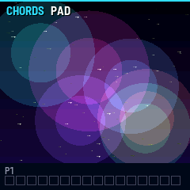
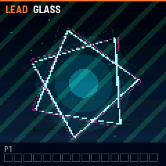
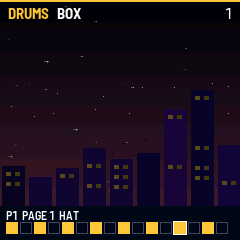
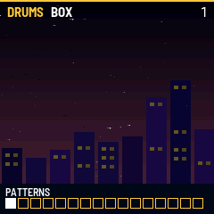

# ALBUM 02

Album is a series of firmwares for the M-VAVE FM-1, one per record. Edition 02 is filter-house: five tracks
(drums, bass, chords, lead and a singing voice) through a bus that pumps on the kick, with a sequencer after the
Arturia KeyStep Pro's. Each of the fifteen patches has its own moving picture, drawn by code, that the sound and
every effect move.

---

## Contents

1. Install
2. Playing
3. The knobs and the effects
4. The patches
5. The sequencer
6. Patterns, scenes and the chain
7. The arpeggiator and chord mode
8. Projects and saving
9. MIDI and the KeyStep Pro
10. Global settings and the two cores
11. Troubleshooting

---

## 1. Install

Try it first in the browser emulator: the same code, with sound. To install, open the install page in Chrome or Edge
with the FM-1 connected by USB. The installer saves a backup first and can put M-VAVE's firmware back.

If Album 02 won't start or the install page can't reach it, hold REC while switching the FM-1 on. With
m-bootloader installed (the install page offers it), that is its update mode, and the install page installs from
there.

## 2. Playing

SELECT picks the track; PRESET picks its patch. The keys play the chosen track, with velocity and pressure. The
screen shows the patch's picture with its name at the top. The bottom shows the current pattern's steps, with the
step playing lit.

| Control | What it does |
| --- | --- |
| Keys | Play the chosen track. On the drums, each key is a part (below). Pressure leans on the sound. |
| SELECT | The track: DRUMS, BASS, CHORDS, LEAD, VOX |
| PRESET | This track's patch (three each) |
| K1 to K4, ALGORITHM | TONE, MOTION, PUMP, SWEEP, SPACE (section 3) |
| EDIT held, K1 to K4 | PHASER, CHORUS, GRIT, ECHO |
| OCT- / OCT+ | This track's octave, two down to two up |
| PLAY | The patterns start from the top, or stop |
| REC | Recording on and off (section 5) |
| HOME | Tapped: every note let go (the patterns play on). Held: the patterns (section 6) |
| SAVE | Keep the project (lit when something changed) |
| MASTER | Volume |

The drums' keys, from the lowest C up: KICK, RIM, SNARE, CLAP, SNARE 2, LOW TOM, HAT, MID TOM, PEDAL HAT, HIGH TOM,
OPEN HAT, BELL. The pattern repeats each octave.

## 3. The knobs and the effects

TONE and MOTION are each track's own: turn them with BASS chosen and only the bass changes. The other three and the
four effects are the whole sound's. Every one moves the picture as well as the sound.

| Knob | The sound | The picture |
| --- | --- | --- |
| K1 TONE | The track's brightness: the filter, the drum kit's top end, the voice's vowel | The scene's colours, its detail |
| K2 MOTION | How much the sound moves: filter envelope, vibrato, pulse width, the drums' decay | How fast the scene moves |
| K3 PUMP | How far everything but the drums ducks at each kick | The whole picture dims on the kick |
| K4 SWEEP | Middle: off. Down: a low-pass closes on everything but the drums. Up: a high-pass opens | An iris: down closes from the edges, up opens a hole in the centre |
| ALGORITHM SPACE | The reverb | The stars' trails lengthen |
| EDIT + K1 PHASER | A slow phaser on everything but the drums | Bands of colour sliding across |
| EDIT + K2 CHORUS | More chorus on the chords | The outlines doubled, in two colours |
| EDIT + K3 GRIT | Fewer samples and fewer steps, like an old sampler | The pixels coarsen |
| EDIT + K4 ECHO | An echo in time: a dotted eighth, left then right | The moving parts trail fading copies |

## 4. The patches

| Track | Patch | The sound | The picture |
| --- | --- | --- | --- |
| DRUMS | BOX | A dry, short early-80s box | A city at night; the hits light its windows |
| | BOOM | A long humming kick, thin hats | A ringed planet; each kick sends a ring out |
| | CLUB | A hard, driven club kit | A dance floor to the horizon, lit on the steps |
| BASS | PLUCK | A short, plucked filter bass | Four strings; the one for the note shakes |
| | ACID | A squelching, resonant line that slides | A molten sun whose rim boils with the filter |
| | ROUND | A round sub | A deep-sea light, rings rising from it |
| CHORDS | PAD | A chorused pad, six voices | A nebula; a cloud for each note |
| | STAB | A filtered stab | Beams fired from the centre at each chord |
| | WIND | Noise whistling at the note through a ringing filter. TONE picks the octave it whistles | A tunnel of streaks; they bunch at the pitch |
| LEAD | BRASS | Detuned saws, a soft filter attack, vibrato that comes in late | A starship over a horizon, climbing with the pitch |
| | GLASS | A two-operator bell | A turning crystal |
| | FUNK | A short stab with fast, wide vibrato | A skyline of bars, bouncing |
| VOX | CHOIR | A child's choir voice, an octave up, sliding between notes | A halo; its petals open with the vowel |
| | ROBOT | A stepped machine voice | An oscilloscope's trace, shaped by the vowel |
| | MONK | A low chant | A moon over water, rippling with the voice |

On VOX, TONE walks the vowel from U through O, A and E to I, and pressing harder opens it further. Notes played over
each other slide.

## 5. The sequencer

Each track has 16 patterns of up to 64 steps. A step holds up to four notes, with a gate, a velocity, a shift in
time and a chance. The patterns play together when PLAY is pressed, each on its own track.

**Step mode (SEQ).** Tap SEQ and the 16 white keys become the steps of the page shown. The lowest four black keys
are the pages: steps 1–16, 17–32, 33–48, 49–64. A step with notes is lit; the step playing has its light flipped.

- Tap an empty step to fill it with the last note or chord played on the track. Tap a filled step to empty it.
- Hold a step and turn: **K1** pitch, **K2** gate, **K3** velocity, **K4** shift (early or late), **ALGORITHM**
  chance. OCT- and OCT+ move it an octave.
- On the drums, steps place one part at a time: ALGORITHM picks which (the screen names it). The steps lit are those
  with that part. A part played on the keys outside step mode becomes the part too.
- Hold SEQ and turn: **ALGORITHM** the pattern's length (1–64), **PRESET** its direction (forward, backward,
  ping-pong, random), **K1** swing (50–75%).

**Recording while it plays.** Press PLAY, then REC (lit), and play. Notes land on the nearest step with the length
they were held. To keep them where they were played, hold GLO and turn K1 to AS PLAYED (section 10). Notes from
MIDI on the track's channel are recorded too.

**Recording a step at a time.** With the patterns stopped, press REC. Each note or chord goes into the next step
when its keys come up. ALGORITHM moves along the steps, which leaves rests. Press REC again to stop.

## 6. Patterns, scenes and the chain

Hold a button and use the white keys; let go to play on. While the patterns play, a change waits for the next bar.

| Hold | Then | What it does |
| --- | --- | --- |
| HOME | A white key | This track's pattern 1–16 (lit: the one playing; dim: ones with notes) |
| HOME | A white key held a second | This pattern copied there, and chosen |
| HOME | REC | This pattern emptied |
| ENV | A white key | A scene recalled: a pattern on every track at once |
| ENV | A white key held a second | The patterns playing now stored as that scene |
| LFO | White keys | Scenes added to the chain, in order |
| LFO | ALGORITHM | Bars for the last scene added (1–64) |
| LFO | OCT- | The last scene taken off the chain |
| FX | The first five white keys | Mute or unmute each track's pattern |

Tap LFO to turn the chain on or off (lit while on). With the chain on, PLAY starts from its first scene, and each
scene plays its bars before the next. That's how a doodle becomes a song: patterns, then scenes made from them,
then a chain of scenes. Tap FX to mute or unmute the chosen track.

## 7. The arpeggiator and chord mode

These work on the FM-1's own keys, whether or not the patterns play. They follow the tempo, or the MIDI clock.

**ARP.** Tap to turn the arpeggiator on or off for this track. Hold ARP and turn: **PRESET** the mode (UP, DOWN,
UP-DOWN + with the ends twice, UP-DOWN, RANDOM, AS PLAYED, REPEAT for the whole chord again), **ALGORITHM** the rate
(1/4 to 1/32, triplets too), **K1** octaves (1–4), **K2** gate, **K3** latch (it keeps playing after the keys are let go).

**Chord mode (SCL).** Hold a chord of two to four keys and tap SCL: every key then plays that chord from its own
note. Tap SCL alone to turn it off and on again. Chord mode and the arpeggiator work together, and what they play is
what gets recorded.

## 8. Projects and saving

A project is everything: the patches, knobs and octaves, the tempo, the patterns, scenes and chain, and each track's
arpeggiator and chord. Four are kept. SAVE keeps the one open, and is lit when something has changed.

To open another, hold GLO, turn PRESET to it (the screen says which are empty) and let GLO go. If the one open has
changes not saved, the FM-1 says so and opens nothing: SAVE first, or choose the other again to open it anyway. To
save into a different one, hold GLO, choose it with PRESET, and press SAVE while still holding GLO.

Saving takes about a second, and the sound stops meanwhile: save between songs rather than during one. A save
interrupted by the power going off loses nothing. The last save stays as it was until the new one is complete.

## 9. MIDI and the KeyStep Pro

MIDI comes in over USB and the TRS jack (Type A) and goes out over USB. There is no Bluetooth in Album 02.

| Track | Channel (the default) |
| --- | --- |
| DRUMS | 1, and always 10 |
| BASS | 2 |
| CHORDS | 3 |
| LEAD | 4 |
| VOX | 5 |

Set the KeyStep Pro's four tracks to channels 1–4 (or 10 for its drum track) and they play the FM-1's first four
tracks. The FM-1's own keys can then sing over them on VOX. Each track's channel can be changed (section 10).

- **Clock.** MIDI clock, start and stop are followed: the patterns, the arpeggiator, the echo and the pump all keep
  the KeyStep Pro's time. The tempo shown is the clock's while it comes.
- **Knobs.** Control changes set the knobs. On a track's channel: CC 74 TONE, CC 71 (and the mod wheel, CC 1)
  MOTION. On any channel: CC 85 PUMP, CC 86 SWEEP, CC 91 SPACE, CC 94 PHASER, CC 93 CHORUS, CC 87 GRIT, CC 88 ECHO.
  CC 120 or 123 lets every note go.
- **Patches.** A program change 1–3 (0–2) on a track's channel picks its patch.
- **Out.** What the FM-1 plays (its keys, the arpeggiator and the patterns) goes out over USB on each track's
  channel, with MIDI clock if chosen (section 10).

## 10. Global settings and the two cores

Hold GLO to see the tempo, the clock, how hard the FM-1 is working, the cores and the project. Turn while holding:

| Turn | What it sets |
| --- | --- |
| ALGORITHM | The tempo, 40–240 (when no MIDI clock is coming) |
| PRESET | The project to open or save into (section 8) |
| K1 | Recording onto the steps, or as played |
| K2 | This track's MIDI channel |
| K3 | One core or two, from the next start |
| K4 | MIDI out: off, notes, or notes and clock |

Tap GLO twice or more in time to set the tempo.

**The two cores.** The FM-1's chip has two cores. Album 02 renders the chords and the echo and reverb on the second
while the first does the rest. Some FM-1s read memory wrong now and then while both run. If the second core misbehaves,
it is given up and the first does all the work until the FM-1 is switched off, without a restart. If a unit keeps
having trouble, hold GLO, turn K3 to ONE CORE, and switch off and on.

## 11. Troubleshooting

- **A note won't stop.** Tap HOME.
- **Nothing plays from the KeyStep Pro.** Check its tracks' channels against section 9. The TRS jack needs a
  Type A adapter.
- **The patterns don't start with the KeyStep Pro.** Send MIDI clock from it; the FM-1 starts on its start
  message.
- **The sound breaks up.** Hold GLO and look at CPU. Fewer chords held, or a shorter SPACE and ECHO, ease it.
- **The FM-1 restarts while playing.** Turn to one core (section 10).

M-VAVE and FM-1 are trademarks of their owners. Album is not affiliated with M-VAVE.
